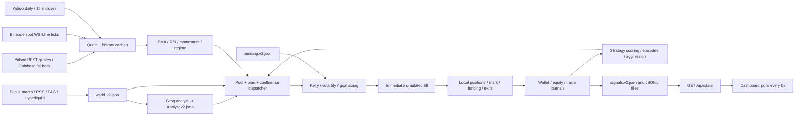

# StockWise V2 architecture audit

Audited source: `50360996451ddc7ad742372bff398b7938ae0029` (2026-10-23).
Audit date: 2026-11-03 (Asia/Kolkata). Branch: `audit/profit-improvements`.
Repository: https://github.com/Dhrub-Kumar-Garg/stockWiseV2

## Scope and what the system actually does

All 44 tracked non-lock, non-binary files were read in full (7,871 text lines,
including documentation, manifests, data ledger and placeholder files). The two
package lockfiles were inventoried and skipped as requested. `web/public/avatar.png`
is a binary presentation asset, visually inspected and hashed rather than line-read.
See `audit/FILE_TREE.md` and `audit/source_inventory.json` for every path, line
count, content hash and reading disposition. No AGENTS.md was found in the repo
or applicable workspace ancestors. No tests, CI workflows, historical data,
user config.json, broker credentials, or executable exchange order adapter were
present in this fresh checkout. The runtime ledger contains 13 candidates and
zero learned trades for all of them; it is not evidence of profitability.

This is a **paper trading simulator on public live prices** and a read-only
Next.js dashboard. All three execution implementations update local objects and
files. None signs or submits exchange/broker orders. The README's descriptions
of autonomous real-money execution, statistically established edge, strict 30s
cadence, actual two-leg arbitrage, and guaranteed honest accounting exceed the
implementation. During initial Phase1–4 work the audit did not start the trading engine, contact Telegram or
Groq, create a live config, run deployment scripts, commit, or push.

## Entry points and dependencies

| Entry | Behavior |
| --- | --- |
| `npm run init` -> `scripts/init.mjs` | Reads root config.json, initializes V2 state and merges strategy seeds; refuses existing file. |
| `npm run daemon` / `cycle` -> `scripts/daemon.mjs` | Older REST-only loop, default 30s sleep **after** work; cycle adds --once. Does not publish dashboard signals, process pending orders, run analyst, poll Telegram, or cache OI. |
| `node scripts/v2/init.mjs [--force]` | Alternative initializer; --force overwrites state and clears pending orders. |
| `node scripts/v2/engine.mjs [--once]` | Newer production entry used by deploy/setup.sh and README; richer loop detailed below. |
| `node scripts/v2/engine_ws.mjs` | Incomplete stand-alone limit-order prototype. Strategy generation is commented out; would throw on `tiers: []`; no durable settlement. |
| `node scripts/v2/fetch_hist.mjs` | Yahoo downloader for BTC, ETH, SPY, daily 730d and 15m 60d; saves data/hist. No exchange order operations. |
| `node scripts/v2/backtest.mjs` | BTC-only position, ETH as indicator; 15m closes mislabeled by daily signal functions; no costs or OOS testing. Prints results, never trains ledger. |
| `node scripts/fix_loop.mjs` | Destructive local recovery script: rewrites episode/generation logs, resets strategies and discards positions into a hardcoded episode 3. Reviewed, never executed. |
| `web` npm dev/build/start | Next 16.2.9, React 19.2.4, Tailwind 4, Recharts; 6s API polling. Root runtime dependency is ws. |
| `deploy/setup.sh` | Installs OS/Node/local npm dependencies, edits firewall/swap/systemd, builds UI and immediately starts services on public port 3002. Read only during this audit. |

There are no dotenv loaders. `scripts/lib.mjs:74` reads only root config.json.
`config.example.json` supplies USD100 V2 capital, USD500/24h goal, 5x starting /
12x ceiling account leverage, 5 slots, 2h max hold, 12% caution / 20% halt DD,
50% margin-ROI trailing activation / 25 percentage point giveback, 5bp taker /
2bp maker perpetual fees, and 10bp crypto slippage per side. The outer USD1000
capital and spot fees mostly do not govern V2. Analyst key is a placeholder in
the example; Telegram token and owner ID are hardcoded in source. Do not copy
the token into reports or use it. The unauthenticated API returns full config.

## Data flow

### Newer engine cycle, actual order

1. Poll Telegram commands; then await FX and parallel REST quotes. WS also
   mutates `_quotes` between awaits; REST can overwrite a newer WS tick. Five
   crypto WS symbols are hardcoded. The multi-stream URL uses the raw endpoint
   incorrectly, and has no heartbeat or payload error isolation.
2. Sequentially refresh 1y daily history for watchlist/indices, plus 5d/15m for
   crypto. Daily TTL 20min; intraday TTL 10min. Histories are arrays of closes
   without timestamps, high/low or volume. Nulls are removed independently, so
   cross-symbol alignment and completed-bar status cannot be established.
3. Enrich quotes: SMA20/50, simple (not Wilder) RSI14, fractional 10-interval
   momentum, trend/bias. Regime from `lib.mjs:419` is `risk_off`, `broad_up`,
   `crypto_down_highvol`, `crypto_down`, `us_down`, or `mixed_chop`; these differ
   from README's listed regimes. ATR is average absolute close change, not true
   range. No general multi-timeframe confirmation is enforced.
4. For each existing position: own EMA mark alpha .25; accrue crypto funding at
   00/08/16 UTC; check liquidation, price stop, price target, 2h time stop, then
   ROI trail. Liquidation/stop/fill use smoothed prices here, not venue marks.
5. Recalculate wallet + locked isolated margins + unrealized P&L. Pending manual
   closes/opens are consumed immediately, then queue is replaced by `[]`. Opens
   bypass halt, stale-price, session and leverage-enabled checks at this path.
6. Unless riskState is halt, run strategy-specific exits and entries, close
   first and open next. The signal and fill use the same quote in the same
   cycle: there is no implemented next-tick queue despite header comments.
7. Update equity peak/DD and overwrite riskState. No daily loss lock exists;
   caution does not reduce sizing. A manual halt can become normal again here.
   On goal/time/equity<=0: close survivors, score strategies, bank lessons,
   adjust aggression and reset episode. New engine ignores autoResetOnBlowup.
8. Await world sources **sequentially**, then Groq when due, then cache OI and
   persist snapshots. These calls block the next risk cycle; analyst and OI are
   used by trading only on subsequent cycles. Sleep 30s after work finishes.

FX is fetched and published but never applied to INR equity fills/quantities or
P&L; India watchlist quotes are treated numerically as USD. US/India are simulated
as perpetual contracts without market-specific financing/borrow or calendars.

## Every strategy: entry and exit

All entries also pass pool/bias/confluence gates. All exits inherit generic
stop/target/time/trailing/liquidation behavior above. Percentages below are
unlevered price moves, not account risk. `retN(c,28)` actually spans **29**
intervals because it subtracts an extra one (`strategies.mjs:136`).

| ID / pool / markets | Actual entry | Strategy-specific exit | Base lev; stop / target |
| --- | --- | --- | --- |
| tsmom / trend / all | return29 >3% and price>SMA200 long; <-3% and below SMA short. SMA gate waived if insufficient history. | Return29 changes sign. | 5x; 4% / 12% |
| donchian / trend / all | Price above/below prior 20 **closes**, excluding latest; SMA200 direction, waived if NaN. | Opposite prior 10-close channel breach. | 5x; 4% / 10% |
| mom_trend / trend / all | Long only: return29 >5%, SMA200 alignment, `q.mom>1`, RSI<78. Since momentum is fractional, >1 means >100% in 10 intervals, not 1%. | Return29 changes sign. | 4x; 4% / 10% |
| orb / trend / US | Starts tracking within 5min of reported session start, samples first 30min quotes, breaks range long/short. No pre-open/session-end validity in signal itself; restarts lose range. | Generic only. | 5x (US max4x); 1.6% / 4% |
| ibreakout / trend / crypto | Latest 15m close exceeds max/min prior48 closes (12h), >=50 bars. | Generic only. | 5x; 1.5% / 8% |
| atr_expand / trend / all | Close-change ATR14 / ATR14 from20 bars ago >=1.3, price breaks prior20-close channel and agrees with previous close. | Price crosses entry +/- current1.5 ATR. | 4x; min(1.5ATR/price,8%) / min(3ATR/price,16%) |
| vol_expand / trend / all | 20-close BB: any last10 bandwidth in bottom20% of last120, expansion>=15% from minimum, price beyond2-sigma band. | Crosses BB middle against position. | 5x; 4% / 10% |
| rsi2dip / revert / all | >=210 daily closes; RSI2<10 aboveSMA200 long; >90 belowSMA200 short. | Long RSI2>=65; short<=35. | 3x; 2% / 5% |
| vwap_revert / revert / crypto | Fade price outside mean(last48 intraday closes) +/-2 sampleSD; needs30 bars. Equal-weight mean, not volume-weighted VWAP. | Price inside +/-0.5SD around updated mean; overshooting across zone may miss exit. | 3x; 2% / 4% |
| orderflow / revert / crypto | Five cached funding values all >.0001 (or <-.0001), OI up>1%; fade crowded long/short side. | Generic only. | 3x; 2% / 5% |
| pairs_trade / both / crypto | First eligible BTC/ETH, SOL/ETH, BTC/SOL pair: 50-close log(A/B) z<-1.5 and A RSI14<40 long A; z>1.5 and RSI>60 short A. Confidence=min(1,abs(z)/3). **No B hedge is opened.** | Only BTC/ETH has z crossing0 exit; no SOL/ETH or recorded BTC/SOL-specific exit. | 3x; 3% / 6% |
| adaptive_regime / both / all | 20-return vol percentile vs90 historical windows: >60% Donchian/SMA direction; <40% RSI2 extreme/SMA direction; middle no entry. | Exit only if percentile in40-60%; direct high-to-low mode change is not tracked. | 4x; 4% / 10% |
| oi_diverge / both / crypto | abs(price change over8 daily closes)>=1.5%, abs(OI delta over8 cycle snapshots)>=3%. OI rising follows price, OI falling fades price. Needs16 snapshots. | Opposite price move >1% with OI rising>2%. | 4x; 3% / 8% |

`runStrategies` loads saved strategies, merges seed risk parameters on every
call, skips only retired status (unproven candidates trade). TREND activates trend
and both; REVERT activates revert and both. No analyst file returns SLEEP.
SLEEP explicitly allows only pairs but halves confidence after clamping to1;
with one strategy and a .6 single-signal threshold, it actually emits no entries.
This is an indirect consequence, not a general latched halt; pending opens remain
possible. The analyst's aggression value is read but never used in sizing.

News lexical mean modifies confidence by .7/.1.2 depending on direction; extreme
fear/greed applies .5 or1.3. Confidence is heuristic, not calibrated probability.
Two or more signals in one direction qualify (long wins a count tie), or a single
signal with confidence>=.6. The top score `confidence*(.5+learned.confidence)`
owns the resulting trade; confirming strategies receive no outcome attribution.
Correlated trend rules are counted separately; there is no decorrelation test,
portfolio covariance model, hedge-ratio estimate or cointegration test. Reentry
cooldown is 2min from emitted order, in memory only, not from exit.

## Position sizing, leverage and accounting

`sizing.mjs` clamps desired leverage to account cap, ceiling, and market maximum
(crypto40, US4, India5). Seed desired leverage3-5x usually binds before the12x
ceiling; unlocking the ceiling does not force seeds above their base leverage.
Maintenance tier maxLev is not enforced by the builder/execution.

For auto strategies it expects `{strategies:[{id,kelly}]}`, but the ledger is
`[{id,learned:{kelly}}]`. Therefore sizing uses **hardcoded .10**, ignoring learned
Kelly. Base fraction = clamp(.10 * clamp(accountKelly/.10,.4,1.6),.02,.40).
Multiply by max(.2,confidence), equity, then volatility scaling: annual target
.60/sqrt365 divided by sample of14 daily log returns (clamped .005-.15), scaling
clamped .25-1.7. If goal progress is between0 and1, increase margin up to55%.
Finally cap margin to98% free wallet. Explicit margin skips the confidence/vol/
goal calculations. No risk-at-stop constraint or portfolio gross/net cap exists.
`maxPositionPct`, `minCashPct`, and risk caution do not govern V2 sizing.

`brain.mjs:147` does estimate a Kelly-like .4*mean(returnOnMargin)/variance after
five closed observations, blends a backtest prior with pseudo-count15, halves
probation, and floors allocation at2% even with negative edge. Before five trades
it returns12% (4% for an explicitly failed backtest). It is neither README's
win/payoff formula nor a consistently applied half-Kelly. Returns called R divide
by **margin**, rather than stop risk. The scorer sees misreported net P&L.

Builder: notional=margin*leverage, qty=notional/adverse entry fill. Margin+entry
fee is removed from wallet. Fixed 5bp taker and configured slippage apply; maker
fee/market impact/spread functions exist but are unused in main execution.
There are no partial fills, venue rounding, actual bid/ask, depth, order ACKs,
rejections, retries or durable client-order IDs.

Closing adds margin+rawPnL-exitFee to wallet. Reported net=rawPnL-exitFee-funding:
it omits entry fee and subtracts a funding number already signed as cashflow.
Funding is never settled into wallet/equity. Thus reports, Kelly training and cash
disagree. Exit fees use entry notional; US borrowAnnual is unused. EMA fills and
approximate liquidation ignore venue maintenance/fees/funding realities and can
debit unrelated free wallet after a gap. See fixtures and findings for numbers.

## Persistence, learning, dashboard and security boundaries

`scripts/lib.mjs` locates data relative to module path; JSON writes rename a
shared fixed `.tmp` file, JSONL appends are synchronous, reads swallow all errors.
No process lock, database transaction, durable consumption ACK, replay protection,
schema version validation, backup/recovery or log rotation exists. Multiple
engines share every file; crash windows can leave journal/state/queue inconsistent.

| State/files | Writer / reader / purpose |
| --- | --- |
| config.json | Operator-authored root config; backend and web read full content. |
| state.v2.json | Either engine; wallet, equity, positions, risk, episode, aggression, lifetime. |
| strategies.json | Tracked seed array; ensureStrategies/scorer rewrite; dispatcher/dashboard read. |
| pending.v2.json | External operator/Telegram close-all; newer engine reads then clears entire array. |
| journal.v2.jsonl | Pre/post trade records; brain pairs by trade_id from last6000 rows. |
| trades.v2.jsonl / equity.v2.jsonl | Simulated fills/closes / marked equity; dashboard reads. |
| episodes.jsonl / generations.jsonl | Episode results, learning/aggression snapshots. |
| memory.jsonl / reflog.v2.jsonl | Heuristic lessons; truncated-SHA hash-linked lifecycle records, no chain verifier. |
| analyst.v2.json / world.v2.json | Groq decision / macro digest; no expiry in reader; stale decisions can persist indefinitely. |
| signals.v2.json / prices.v2.json | Only newer engine publishes dashboard digest and quotes/FX. `FAB_SIGNALS` changes signals writer path, API ignores it. |
| backtest_stats.json | Brain prior reader only; existing backtest does not write it. |
| world_thesis.v2.json, world_cache_v2, calibration.json, playbook.json and legacy paths | Declared but unused or not written by active V2 flow. |

Scorer computes expectancy, Wilson bound, PF, SQN, t statistic and an approximate
deflated Sharpe on trade margin returns. Candidate promotion needs>=30 trades and
several gates; negative candidates are never retired unless first promoted.
Active -> probation -> retired based on recent30 trades. Learned PF and DSR are
not stored although UI expects them. Memory lessons are displayed/retrieved; they
do not constrain entries or sizing. Four good trades can repeatedly increase
aggression on the same evidence every8min. Episode reset clears DD and halt; after
ruin it creates fresh capital. Lifetime loss/deposit accounting is absent.

`GET /api/state` synchronously reads config/state/strategies and full JSONL files,
then slices/downsamples. It has no authentication or config redaction. Root polls
every6s with overlapping requests possible and keeps stale data after error;
dashboard hardcodes a live indicator and chart start=$100. PnL range totals also
subtract $100 rather than the selected range start. Lessons UI expects lesson/
kind/title, but writer emits text/type. Both leak/misreport findings are local
source evidence; no live site or credentials were queried.

## Verification boundary

`audit/` contains only new research/proof tooling and outputs. Application source
and deploy files are unchanged. Source-backed deterministic reproductions are
in `audit/results/checks.json`; historical replay methodology and its deviations
from deployment are in `audit/EXPERIMENT_PLAN.md` and `BACKTEST_RESULTS.md`.
Historical spot OHLCV cannot prove execution quality, equity-market edge,
historical AI routing, partial-fill behavior or actual financing. No profitability
claim is warranted for an unobserved live system.
